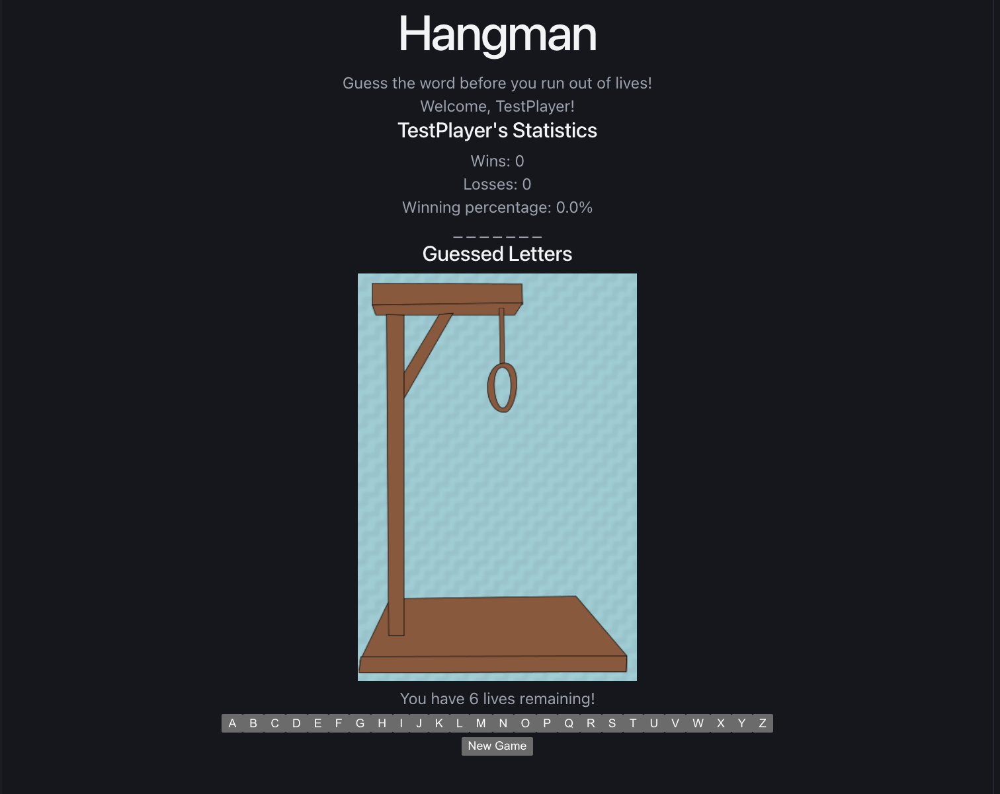
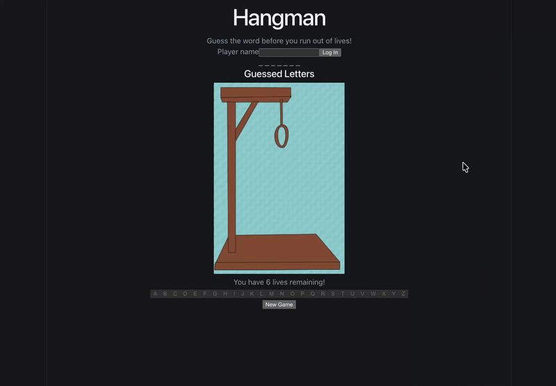

# Hangman

A React Hangman game with persistent player statistics, an Express API, and DynamoDB Local.

## Table of Contents

- [Description](#description)
- [Screenshot](#screenshot)
- [Demo](#demo)
- [Getting Started](#getting-started)
- [Usage](#usage)
- [Project Structure](#project-structure)
- [API Endpoints](#api-endpoints)
- [Testing](#testing)
- [Stopping the Project](#stopping-the-project)
- [Technologies Used](#technologies-used)
- [AI Contribution](#ai-contribution)

## Description

Players select letters to reveal a hidden word. Each incorrect guess
advances the hangman image and reduces the remaining lives. The game
displays previously guessed letters, shows a win or loss popup, and
allows players to start another round with a different word.

Players enter a name to find an existing record or create a new one.
Each record has a unique playerID, allowing multiple players to share
a name without overwriting one another's statistics. When multiple
records match a name, the player can select their record.

The game displays wins, losses, and winning percentage. Completed
rounds update React state first, then save the totals through the API
to DynamoDB. Failed saves display a retry option.

Player selection is name-based and does not use passwords or
authenticate identity.

## Screenshot



## Demo



## Getting Started

### Prerequisites

- Git
- Docker Desktop with Docker Compose

Node.js and npm run inside the containers, so a separate local Node.js
installation is not required for the Docker setup.

### Installation and Startup

Clone the repository:

```bash
git clone <your-repository-url>
```

Enter the cloned project folder containing `docker-compose.yml`.

Make sure Docker Desktop is running, then build and start the project:

```bash
docker compose up --build
```

Keep this terminal running. Startup prepares the database storage,
creates the Players table if needed, and starts the API and frontend.

Open these addresses:

| Service | Address |
|---|---|
| Hangman game | http://localhost:3000 |
| API health check | http://localhost:3001/health |
| DynamoDB Admin | http://localhost:8001 |

Ports 3000, 3001, 8000, and 8001 must be available. Stop any manually
running Vite or API processes using those ports before starting Compose.

## Usage

1. Enter your player name and select Log In.
2. An existing player record is loaded, or a new record is created.
3. If multiple players share the name, select the appropriate record.
4. View your wins, losses, and winning percentage.
5. Select a letter to guess whether it appears in the hidden word.
6. Correct guesses reveal every matching letter.
7. Incorrect guesses reduce your six lives and advance the hangman image.
8. Previously guessed letters are displayed and disabled.
9. Reveal the entire word before running out of lives to win.
10. When the round ends, the result popup appears and statistics are saved.
11. If saving fails, select Retry Save.
12. Select New Game after saving to play another round with a different word.

## Project Structure

- `src/`: React game components, player login, and statistics display.
- `public/`: Hangman images and other public assets.
- `server/server.js`: Express API routes and input validation.
- `server/db.js`: DynamoDB client configuration.
- `server/createTable.js`: Creates the Players table and player-name index.
- `Dockerfile`: Builds and starts the frontend container.
- `server/Dockerfile`: Builds and starts the API container.
- `docker-compose.yml`: Starts the frontend, API, database, and admin interface.
- `.dockerignore` and `server/.dockerignore`: Exclude unnecessary files from builds.

### Database

The Players table stores:

- `playerID`: Unique string used as the primary key.
- `playerName`: Player's display name.
- `wins`: Number of wins.
- `losses`: Number of losses.

The `playerName-index` secondary index supports queries by name.
Updates target a playerID so records with the same name remain separate.

DynamoDB data is stored in a named Docker volume.

## API Endpoints

The API runs at `http://localhost:3001`.

| Method | Endpoint | Purpose |
|---|---|---|
| GET | `/health` | Confirm the API is running |
| POST | `/players` | Create a player |
| GET | `/players?playerName=Ellington` | Find players by name |
| PUT | `/players/:playerID` | Update a player's wins and losses |

### Create a Player

POST `/players`

JSON request body:

```json
{
  "playerName": "Ellington"
}
```

Returns `201 Created` with the generated ID, name, and zero wins and losses.
Invalid names return `400 Bad Request`.

### Find Players

GET `/players?playerName=Ellington`

Returns `200 OK` with an array of matching records. If no player is found,
returns `404 Not Found`. Missing or invalid names return `400 Bad Request`.

### Update Statistics

PUT `/players/<playerID>`

JSON request body:

```json
{
  "wins": 1,
  "losses": 0
}
```

Replace `<playerID>` with an actual ID returned by POST or GET.

Returns `200 OK` with the updated player. Totals must be nonnegative
integers; invalid totals return `400 Bad Request`. An unknown ID returns
`404 Not Found`.

This endpoint replaces the totals rather than incrementing them, allowing
the same save request to be retried without counting a round twice.

## Testing

### API Testing with Postman

Start the project through Docker Compose before testing.

For POST and PUT requests, select Body → raw → JSON in Postman.

| Test | Expected Result |
|---|---|
| GET `/health` | 200 with a server-running message |
| POST `/players` with a valid name | 201 with a new player record |
| POST `/players` with an empty name | 400 |
| GET `/players?playerName=Ellington` after creating that player | 200 with matching records |
| GET with a name that has not been created | 404 |
| PUT valid totals using an existing playerID | 200 with updated statistics |
| PUT a negative win count | 400 |
| PUT valid totals using an unknown playerID | 404 |

After updating statistics, repeat the GET request to confirm the saved totals.

To test duplicate names, send the same POST request twice. Confirm that
the returned playerIDs differ and that GET returns both records.

### Frontend Testing

- Log in with an existing name and confirm saved statistics appear.
- Enter a new name and confirm the record starts with zero statistics.
- Verify correct guesses reveal letters without reducing lives.
- Verify incorrect guesses reduce lives and advance the image.
- Verify guessed buttons cannot be selected again.
- Win a round and confirm wins increase by exactly one.
- Lose a round and confirm losses increase by exactly one.
- Refresh and log in again to confirm statistics were saved.
- Look up a duplicate name, select a record, and confirm only that
  record's statistics change after a round.
- Confirm New Game clears guesses, restores lives, and changes the word.

### Persistence Testing

Stop the project, then start it again:

```bash
docker compose down
docker compose up --build
```

Log in with a previous player and confirm their statistics remain.

### Troubleshooting

View container status:

```bash
docker compose ps -a
```

View API and database logs:

```bash
docker compose logs --tail=50 api dynamodb-local
```

The `dynamodb-init` service is expected to finish with exit code 0 after
preparing storage permissions.

## Stopping the Project

Press Ctrl+C in the terminal running Compose, then run:

```bash
docker compose down
```

This preserves the database volume. Avoid `docker compose down -v`
unless you intend to delete the stored player data.

## Technologies Used

- React
- Vite
- Node.js
- Express
- CORS middleware
- AWS SDK for JavaScript v3
- DynamoDB Local
- DynamoDB Admin
- Docker and Docker Compose
- Postman for API testing

## AI Contribution

See the AI contribution statement included in this repository for details
about the assistance used during development.