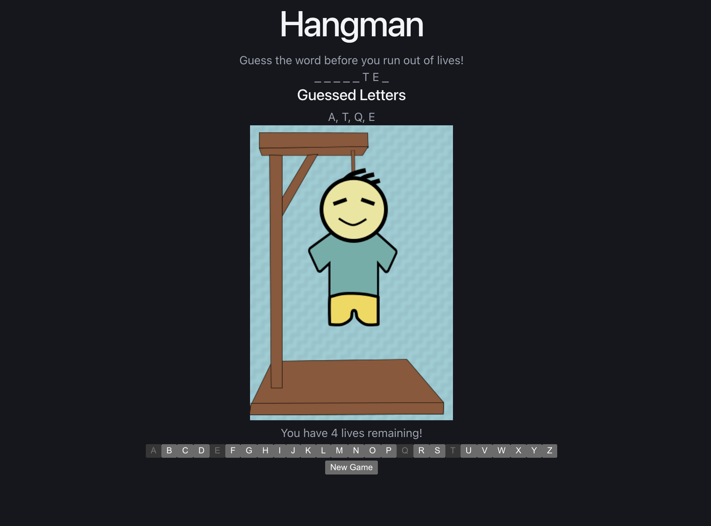
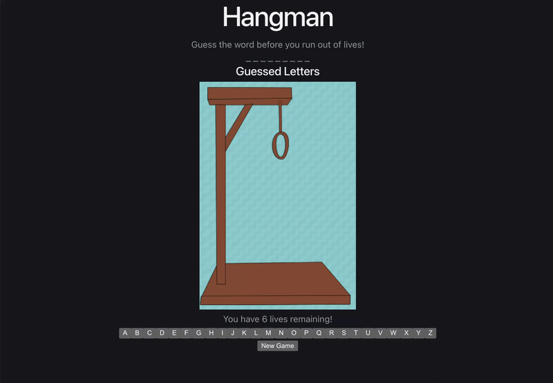

# Hangman 
---

## Table of Contents

- [Description](#description)
- [Screenshot] (#screenshot)
- [Demo](#demo)
- [Getting Started](#getting-started)
- [Usage](#usage)
- [Running with Docker](#running-with-docker)
- [Technologies Used](#technologies-used)
- [License](#license)

---

## Description

A Hangman game built with React and Vite. Players select letter buttons to reveal a hidden word. Each incorrect guess adds a part to the hangman and reduces the remaining lives. The game displays previously guessed letters, shows a win or loss popup, and lets players start another round with a different word.

---

## Screenshot


---

## Demo


---

## Getting Started

### Prerequisites: 
Ensure these are installed before running!
Node.js v24, npm, and Git

```bash
# 1. Fork this repository to your own GitHub account, then clone your fork
git clone <your-fork-url>

# 2. Move into the project directory
cd hangman

# 3. Install dependencies needed for the project
npm install

# 4. Start the development server
npm run dev

# 5. Open the shown local address(in terminal) in a web browser
```
---

## Usage

1. Select a letter to guess whether it appears in the hidden word.
2. Correct guesses reveal every matching letter.
3. Incorrect guesses reduce your six lives and advance the hangman image.
4. Previously guessed letters are displayed and disabled.
5. Reveal the entire word to win before your lives reach zero.
6. Select New Game to reset the game and choose a different word.

---

## Running with Docker

Requires [Docker](https://www.docker.com/) and [Docker Compose](https://docs.docker.com/compose/).

```bash
# Build and start the container
docker compose up --build

# Stop the container
docker compose down
```

The app will be available at `http://localhost:3000`.

---
## Technologies Used

- [React](https://react.dev/)
- [Vite](https://vitejs.dev/)
- [Node.js](https://nodejs.org/)
- [Docker](https://www.docker.com/) 
